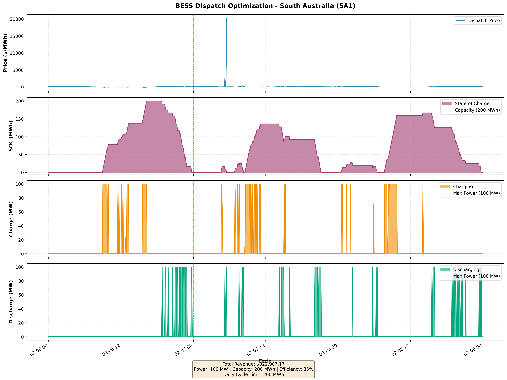

# BESS Dispatch Optimization

How much could a 100 MW / 200 MWh battery have earned by trading in the
South Australian electricity market (SA1) over three days in February 2026?
This project answers that with a linear program solved on real 5-minute
market prices. It was written as a technical assessment.

**Best possible revenue: $322,987.17 over 3 days.** This is a
perfect-foresight figure: the optimiser sees each day's prices in advance,
so it is the most the battery could have earned, an upper bound for any
real trading strategy.

**Data:** AEMO's public 5-minute price and demand data for SA1
(`PRICE_AND_DEMAND_202602_SA1.csv`, 6 to 8 February 2026, 864 intervals).



## Results

| Day | Revenue | Prices |
|---|---|---|
| 6 Feb 2026 | $59,886.37 | -$185 to $299/MWh |
| 7 Feb 2026 | $222,718.45 | spike to $20,300/MWh, the market price cap |
| 8 Feb 2026 | $40,382.35 | -$8 to $301/MWh |
| **Total** | **$322,987.17** | average $107,662.39 a day |

- **One spike made most of the money.** The 7 February spike produced 69%
  of the three-day total. Because the optimiser knows the spike is coming, it
  holds charge for it. A real trader would not know, which is why this is a
  best case.
- **The cycle limit binds every day.** Each day discharges exactly the
  200 MWh allowed (235.3 MWh charged, after the 85% efficiency).
- **Negative prices are used.** All three days had negative prices, and the
  battery charges when it is paid to.

## Method

A linear program per day, solved with `scipy.optimize.linprog` (HiGHS).
For a linear problem like this one the solver finds the true optimum.

**Decision variables** for each 5-minute interval t: energy charged
`charge[t]`, energy discharged `discharge[t]` and state of charge `soc[t]`,
all in MWh.

**Objective:** maximise `sum over t of (discharge[t] - charge[t]) x price[t]`.

**Constraints:**

1. Power: `0 <= charge[t], discharge[t] <= 100 MW x 5/60 h`
2. Energy: `0 <= soc[t] <= 200 MWh`
3. Storage: `soc[t] = soc[t-1] + 0.85 x charge[t] - discharge[t]` (the 85%
   round-trip efficiency is applied on charging)
4. The battery starts and ends each day empty
5. At most 200 MWh discharged per day (one full cycle)

## How to run it

```bash
pip install -r requirements.txt
python bess_optimization.py
```

It reads the CSV in the same folder, prints the daily revenue, and writes
`bess_optimization_results.png` and `bess_optimization_detailed_results.csv`
(interval-by-interval results). Re-running it reproduces the totals above
exactly.

## Checks in the code

- No missing 5-minute intervals and no duplicate timestamps in the data.
- The solver must report success.
- It prints the maximum state of charge and each day's throughput, so the
  limits can be checked by eye.

## Limits and next steps

- **Perfect foresight.** Swapping the real prices for a price forecast, and
  measuring how much of the $322,987 a forecast-driven strategy keeps, is the
  natural next step.
- **Each day is solved separately** and must end empty; a multi-day horizon
  would let charge carry over.
- **The model allows charging and discharging in the same interval.** The
  optimal solution never does this here, but a binary constraint would rule
  it out.
- **The constraint matrices are dense**, which is fine for 288 intervals a
  day but would need sparse matrices for a year.
- No battery degradation, ramp rates or ancillary (FCAS) markets.

## Asset parameters

| Parameter | Value |
|---|---|
| Power | 100 MW |
| Energy | 200 MWh (2-hour duration) |
| Round-trip efficiency | 85% (applied on charge) |
| Start and end of each day | Empty |
| Daily cycle limit | 200 MWh discharged |

## Author

Tiiso Letsapa, Letsapamyron07@gmail.com. Python, SciPy (HiGHS), pandas,
Matplotlib.
